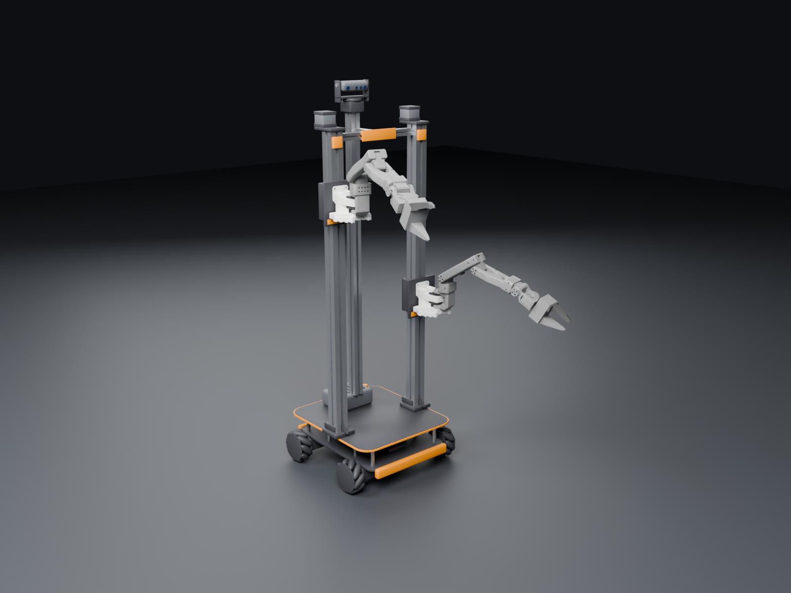
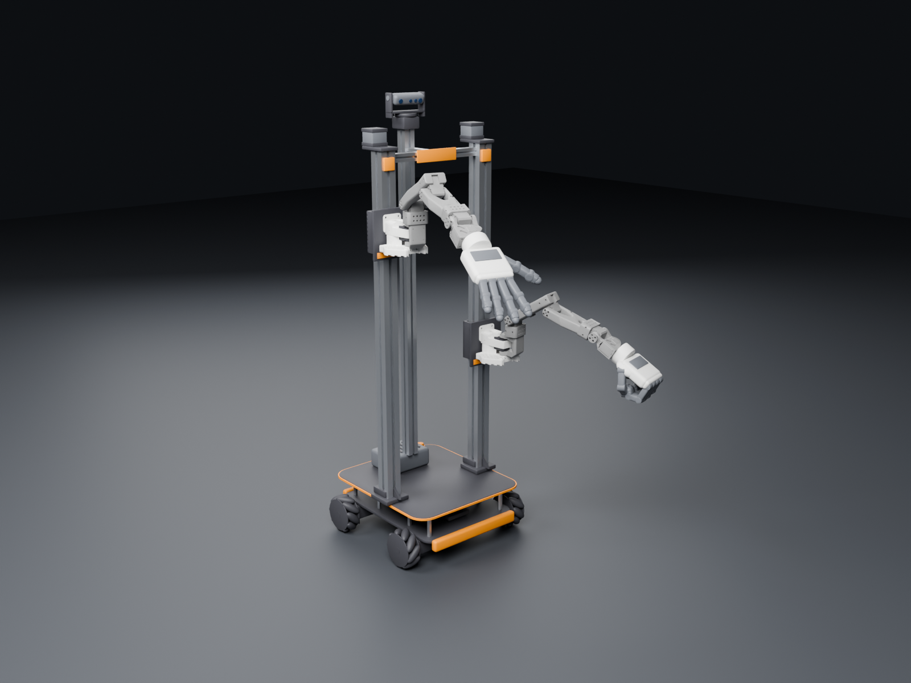
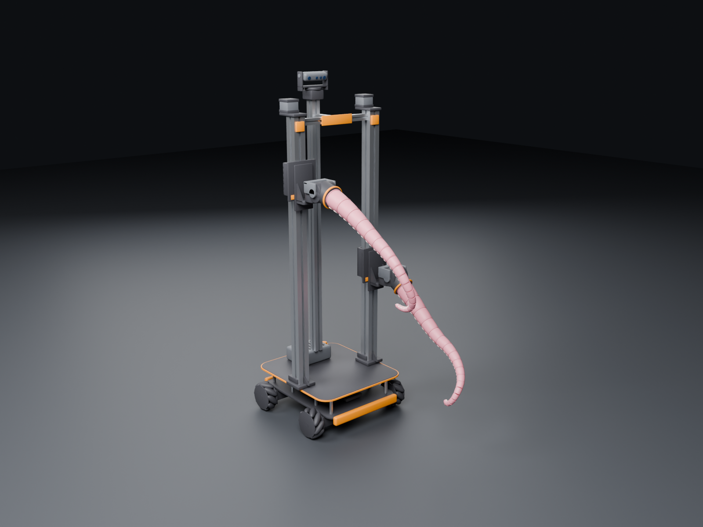
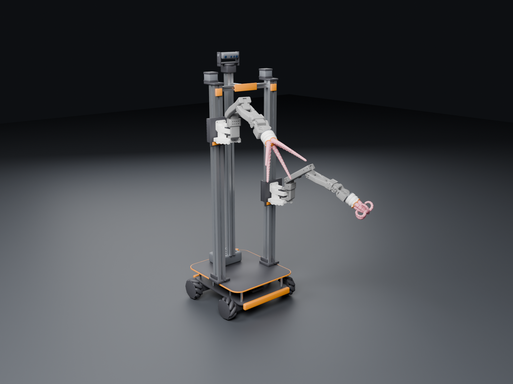

# XLeRobot five-manipulator STL package

Printer-scale STL files for all five XLeRobot-MM manipulator configurations, plus the shared 710 mm vertical lift. The files are already converted to **millimetres** and can be opened directly in a slicer or GitHub's 3D viewer.

<table>
  <tr>
    <td align="center"><br><code>two_jaw</code></td>
    <td align="center"><br><code>three_jaw</code></td>
    <td align="center"><br><code>five_finger</code></td>
  </tr>
  <tr>
    <td align="center"><br><code>tentacle</code></td>
    <td align="center"><br><code>five_tentacle</code></td>
    <td align="center"><strong>Vertical lift</strong><br>190–900 mm shoulder height<br>710 mm usable travel</td>
  </tr>
</table>

## What is included

| Configuration | STL directory | Shared arm | End effector / mechanism |
|---|---|---|---|
| Two jaw | [`stl/two_jaw`](stl/two_jaw/) | [`stl/common_so100_arm`](stl/common_so100_arm/) | Original SO-100 parallel jaw |
| Three jaw | [`stl/three_jaw`](stl/three_jaw/) | [`stl/common_so100_arm`](stl/common_so100_arm/) | Three adaptive two-link fingers |
| Five finger | [`stl/five_finger`](stl/five_finger/) | [`stl/common_so100_arm`](stl/common_so100_arm/) | Left- and right-handed palms and five articulated digits |
| Tentacle | [`stl/tentacle`](stl/tentacle/) | Replaces the SO-100 arm | Shoulder mount plus 18 correctly tapered continuum segments |
| Five tentacle | [`stl/five_tentacle`](stl/five_tentacle/) | [`stl/common_so100_arm`](stl/common_so100_arm/) | Hub plus five sets of 12 correctly tapered segments |
| Vertical motion | [`stl/vertical_lift`](stl/vertical_lift/) | Used by every configuration | Lead-screw carriage and roller-location reference |

The exact quantity and suggested material for every file is in [`BOM.csv`](BOM.csv). [`manifest.json`](manifest.json) records source meshes, scale factors, dimensions, triangle counts, topology statistics, and SHA-256 checksums.

## Vertical up/down motion

Each arm uses one independent Z-stage:

- shoulder height: **190–900 mm**;
- usable vertical travel: **710 mm**;
- guide: 40 × 40 mm T-slot extrusion;
- drive: T8 lead screw and NEMA 17 stepper;
- carriage: `vertical_lift/carriage_body.stl`;
- guidance: four V-groove rollers, positioned by `carriage_rollers_and_accent_reference.stl`;
- simulated maximum lift speed: 120 mm/s (software is rate-limited to 150 mm/s).

The rollers, bearings, T-slot extrusion, lead screw, lead nut, coupler, end stops, and NEMA 17 are off-the-shelf hardware, not plastic replacements. The roller/accent STL is an assembly-position reference containing disconnected shells; do not install it as one printed mechanism. Use hard travel stops and limit switches at both ends before powered testing.

## Printing notes

- Import at **100% scale** in millimetres. Do not apply another 1000× scale.
- Use PETG or PETG-CF for rigid load-bearing parts. Use TPU 95A for continuum bodies and TPU 85A for sucker overlays.
- Tentacle body and sucker files with the same segment number share an origin. Load them together for dual-material printing, or use them as aligned mould/overmould references.
- `hand_palm_p` and `hand_palm_n` are opposite chiralities. Print the version whose thumb points toward the robot centre line.
- The motor-labelled SO-100 meshes are fit/reference envelopes from the existing robot model. Use the actual Feetech servos for an operating robot.
- Select layer height, wall count, infill, orientation, supports, and tolerances for your printer and expected load. Perform a dry fit before installing motors or tendons.

These meshes reproduce the repository's parametric MuJoCo/Blender design. They have been checked for readable binary STL structure, finite non-zero bounds, non-degenerate triangles, deterministic checksums, and correct millimetre scale. They are not a substitute for load testing, collision checks, or machine-specific tolerance calibration.

All 113 files have zero open boundary edges. The original `Rotation_Pitch` and `Lower_Arm` meshes and the multi-solid lift carriage contain coincident/shared edges where closed shells touch; these are recorded as `nonmanifold_edges` in the manifest. Inspect your slicer's union result for those three files before printing a load-bearing assembly.

## Rebuild and verify

The committed files require no external CAD package. From the repository root:

```bash
python3 hardware/manipulators/tools/export_stls.py --check
```

To regenerate every STL, preview, BOM entry, and checksum from the existing source meshes:

```bash
python3 hardware/manipulators/tools/export_stls.py
```

The exporter uses only Python's standard library. Source geometry remains in `simulation/mujoco_multi/assets`, `simulation/xlerobot/meshes/xlerobot/assets`, and the parametric definitions in `simulation/mujoco_multi/blender/build_parts.py`.

## License

This package is distributed under the repository's [Apache License 2.0](../../LICENSE).
